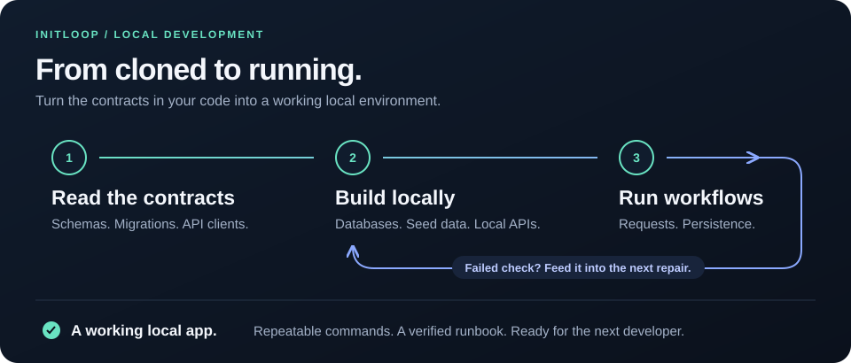

<h1></h1>

### Develop locally—even when the dependencies aren’t available.

Unreachable database? Missing seed data? An API you can’t access?
**Initloop helps your coding agent build the local dependencies your app needs.**

It uses schemas, migrations, API contracts, and integration code already in your repo
to build local databases, seed realistic synthetic data, and run substitutes for external APIs.
Then it exercises your app against them and repairs what fails—until the useful workflow works.



**You get:** a working local app, repeatable dev commands, and a verified runbook.
Existing native and Compose setups stay in place. It uses the model you already have.

## Get started

From your project:

```sh
npx skills add jwerd/initloop
```

Choose your agent, then ask:

```text
$initloop Get this project working locally.
```

Use `/initloop` in Claude Code. Start a fresh session if the skill isn’t listed.
No extra model API key or AI service to configure.

## Built for the next developer, too

Initloop checks setup, useful requests, persistence and the change/test cycle.
It leaves linked **AGENTS.md / CLAUDE.md, a stack reference and a development runbook**
so the next session can pick up where you left off.

Local substitutes reproduce the behavior your app needs. Inferred schemas and API
simulations are labeled provisional; unknown provider behavior stays explicit.

---

**Alpha.** Installer: Node22.20+ and Git. Helpers: Python3.9+ and Git. Docker is optional;
native lifecycle requires Linux/macOS and runs with host permissions.

[Install options, pinning & updates](CONTRIBUTING.md#installation-maintenance) ·
[Releases](https://github.com/jwerd/initloop/releases) ·
[Helper reference](skills/initloop/references/controller.md) ·
[Harness support](skills/initloop/references/harnesses.md) ·
[Security](SECURITY.md) · [Contribute](CONTRIBUTING.md) · [MIT](LICENSE)

Try the [interactive dependency checkpoint demo](skills/initloop/references/dependency-demo.md) from a checkout. It uses labeled synthetic facts and applies no setup.
